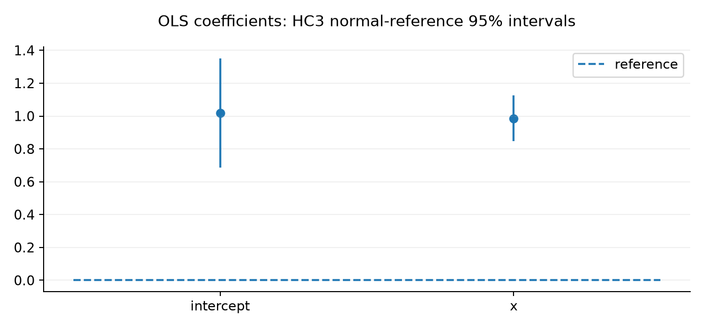

# STATADIC


*stat·adic* · /stəˈtædɪk/ · stuh-TAD-ik

A coined name from **statistic + dyadic**. A
[dyad](https://www.merriam-webster.com/dictionary/dyad) is a pair considered
together: two people, two observations, two parts of a whole. STATADIC suggests
statistical methods coming together in one analysis.

[](https://marcusinthesky.github.io/statadic/)
[](https://doi.org/10.5281/zenodo.22689254)
[](https://pypi.org/project/statadic/)  

[](src/python/packages/statadic/docs/start/installation.md)
[![Lean 4.35.0](https://img.shields.io/badge/Lean-4.35.0-0E7490?logo=data%3Aimage%2Fsvg%2Bxml%3Bbase64%2CPHN2ZyB3aWR0aD0iMjQwMCIgaGVpZ2h0PSI5MDAiIHZpZXdCb3g9IjAgMCAyNDAwIDkwMCIgZmlsbD0ibm9uZSIgeG1sbnM9Imh0dHA6Ly93d3cudzMub3JnLzIwMDAvc3ZnIj48cGF0aCBkPSJNMTUxNy40MyA3NDEuMDM2VjIxMy41NTFMMTQwOC44NiA0NTQuOTk3QzE0MDguODQgNDU1LjAzOSAxNDA4LjgzIDQ1NS4wODMgMTQwOC44MSA0NTUuMTI1TDEyNzQuODcgNzQzLjE2N0MxMjczLjA3IDc0Ny4wMjUgMTI2OS4yMSA3NDkuNDk4IDEyNjQuOTYgNzQ5LjUwOUwxMjYwLjQ5IDc0OS41MkMxMjU2LjIxIDc0OS41MyAxMjUyLjMxIDc0Ny4wNDIgMTI1MC41MSA3NDMuMTUzTDExMTcuNDkgNDU1LjE1TDEwMDMuNSAyMTEuNzAyVjczOC41NTZDMTAwMy41IDc0NC42MTEgOTk4LjU4OSA3NDkuNTIgOTkyLjUzNiA3NDkuNTJIMjU2Ljk2MUMyNTAuOTA4IDc0OS41MiAyNDYuMDAxIDc0NC42MTEgMjQ2IDczOC41NTZWMTU5Ljk2NEMyNDYgMTUzLjkwOSAyNTAuOTA3IDE0OSAyNTYuOTYxIDE0OUMyNjMuMDE0IDE0OSAyNjcuOTIxIDE1My45MDkgMjY3LjkyMSAxNTkuOTY0VjcyNy41OTJIOTgxLjU3NlY0NjEuNDY0SDYyNC43NUM2MTguNjk3IDQ2MS40NjQgNjEzLjc5IDQ1Ni41NTUgNjEzLjc5IDQ1MC41QzYxMy43OSA0NDQuNDQ1IDYxOC42OTcgNDM5LjUzNiA2MjQuNzUgNDM5LjUzNkg5ODEuNTc2VjE3My40MTFINjI0Ljc1QzYxOC42OTcgMTczLjQxMSA2MTMuNzkgMTY4LjUwMiA2MTMuNzkgMTYyLjQ0OEM2MTMuNzkgMTU2LjM5MyA2MTguNjk3IDE1MS40ODQgNjI0Ljc1IDE1MS40ODRIOTkyLjUzNkw5OTMuMzI4IDE1MS41MTNDOTk3LjI2NCAxNTEuNzk3IDEwMDAuNzcgMTU0LjE4NSAxMDAyLjQ2IDE1Ny43OTdMMTEzNC4zOCA0MzkuNTM2SDEzOTEuNzhMMTUxOC4zOSAxNTcuOTUxQzE1MjAuMTYgMTU0LjAxNSAxNTI0LjA3IDE1MS40ODQgMTUyOC4zOSAxNTEuNDg0SDE1MzAuODJDMTUzNC4xNSAxNTEuNDg0IDE1MzcuMjkgMTUyLjk5MyAxNTM5LjM3IDE1NS41ODVMMTk4NS4wOCA3MTAuOTA0VjE1OS45NjRDMTk4NS4wOCAxNTMuOTA5IDE5ODkuOTkgMTQ5IDE5OTYuMDQgMTQ5QzIwMDIuMDkgMTQ5IDIwMDcgMTUzLjkwOSAyMDA3IDE1OS45NjRWNzM5LjA0MUMyMDA3IDc0NS4wOTYgMjAwMi4wOSA3NTAuMDA1IDE5OTYuMDQgNzUwLjAwNUgxOTkzLjZDMTk5MC4yOCA3NTAuMDA1IDE5ODcuMTQgNzQ4LjQ5NiAxOTg1LjA2IDc0NS45MDRMMTUzOS4zNSAxOTAuNTgxVjc0MS4wMzZDMTUzOS4zNSA3NDcuMDkxIDE1MzQuNDQgNzUyIDE1MjguMzkgNzUyQzE1MjIuMzMgNzUyIDE1MTcuNDMgNzQ3LjA5MSAxNTE3LjQzIDc0MS4wMzZaTTEyNjIuNzIgNzE3LjI5NkwxMzgxLjY4IDQ2MS40NjRIMTE0NC41NUwxMjYyLjcyIDcxNy4yOTZaIiBmaWxsPSIjMDcwMDAwIi8%2BPHBhdGggZD0iTTIwNTEuMDggMTYzLjk2NVYxNTUuMDkxSDIwOTIuODlWMTYzLjk2NUgyMDc3LjMxVjIwNkgyMDY2LjY3VjE2My45NjVIMjA1MS4wOFoiIGZpbGw9IiNCN0I3QjciLz48cGF0aCBkPSJNMjA5OS43OCAxNTUuMDkxSDIxMTMuMDVMMjEyNy4wNyAxODkuMjk1SDIxMjcuNjdMMjE0MS42OSAxNTUuMDkxSDIxNTQuOTZWMjA2SDIxNDQuNTJWMTcyLjg2NEgyMTQ0LjFMMjEzMC45MiAyMDUuNzUxSDIxMjMuODFMMjExMC42NCAxNzIuNzRIMjExMC4yMlYyMDZIMjA5OS43OFYxNTUuMDkxWiIgZmlsbD0iI0I3QjdCNyIvPjwvc3ZnPg%3D%3D)](https://lean-lang.org/)
[](infra/nix/flake.nix)  

[](src/python/packages/statadic/CHANGELOG.md)
[](LICENSE)

**From statistical question to publication-ready results.**

Fit familiar models, compose richer analyses, and carry the assumptions,
diagnostics and evidence through to your final tables and figures. STATADIC
brings regression, ordination and distribution-based analysis into one consistent
Python workflow, built on JAX.

**Specify → Estimate → Diagnose → Infer or predict → Report.**

[Start](src/python/packages/statadic/docs/start/index.md) ·
[Choose a method](src/python/packages/statadic/docs/methods.md) ·
[Explore the evidence](src/python/packages/statadic/docs/validation/index.md) ·
[Blog](src/python/packages/statadic/docs/blog/index.md)

## See it in action

Estimate a line, request HC3 uncertainty, and export a manuscript table and figure:

<!-- statadic:readme-ols:start -->

```python
from pathlib import Path

from statadic.observation.design import Intercept, Linear
from statadic.hypothesis.uncertainty import HC
from statadic.regression import Regression

data = {
    "x": [0.0, 1.0, 2.0, 3.0, 4.0, 5.0],
    "y": [1.1, 1.8, 3.2, 3.7, 5.3, 5.8],
}
fit = Regression.ols("y", Intercept() + Linear("x")).estimate(data).require_valid()
report = fit.infer(covariance=HC("HC3")).report(reference="normal")

print(report.to_text())
report.save_latex(Path("regression.tex"))
report.coefficient_plot().save_pgfplots(Path("coefficients.tex"))
```

<!-- statadic:readme-ols:end -->

<!-- statadic:readme-table:start -->

| Parameter | Estimate | HC3 SE | 95% interval |
| --- | --- | --- | --- |
| intercept | 1.0190 | 0.1701 | [0.6857, 1.3524] |
| x | 0.9857 | 0.0708 | [0.8470, 1.1244] |

<!-- statadic:readme-table:end -->



Include the exported table directly in your manuscript with:

```latex
% Preamble: \usepackage{booktabs,siunitx}
\begin{table}
  \input{regression.tex}
  \caption{OLS estimates with HC3 standard errors.}
\end{table}
```
with publication quality `pgfplots` and diagnostics.   

## Everything in one place

Rather than 10 different libraries with conflicting dependencies and incompatible API, use one library that combines them under one simple install: 

| Library | OLS | WLS | GLM | GAM | FE | RE | FMB | IV/GMM | SAR/SEM | S-IV | S-Panel | AFT | Censor | MMD | Energy | OT | Dist | HAC | Mantel | Cov | QP | KPCA/ISO | FL |
|---|---|---|---|---|---|---|---|---|---|---|---|---|---|---|---|---|---|---|---|---|---|---|---|
| STATADIC | ✓ | ✓ | ✓ | ◐ | ✓ | ✓ | ✓ | ✓ | ✓ | ✓ | ✓ | ✓ | ✓ | ✓ | ✓ | ✓ | ✓ | ✓ | ✓ | ✓ | ✓ | ✓ | ✓ |
| statsmodels | ✓ | ✓ | ✓ | ✓ | ◐ | ◐ | — | ✓ | — | — | — | — | ✓ | — | — | — | — | ✓ | — | ✓ | — | — | — |
| linearmodels | ✓ | ✓ | — | — | ✓ | ✓ | ✓ | ✓ | — | — | — | — | — | — | — | — | — | ✓ | — | — | — | — | — |
| spreg | ✓ | — | ◐ | — | ✓ | ✓ | — | ✓ | ✓ | ✓ | ✓ | — | — | — | — | — | — | ✓ | — | — | — | — | — |
| lifelines | — | — | — | — | — | — | — | — | — | — | — | ✓ | ✓ | — | — | — | — | — | — | — | — | — | — |
| glum | ✓ | ✓ | ✓ | ◐ | ◐ | — | — | — | — | — | — | — | — | — | — | — | — | — | — | — | — | — | — |
| arch | ◐ | — | — | — | — | — | — | — | — | — | — | — | — | — | — | — | — | ✓ | — | — | — | — | — |
| POT | — | — | — | — | — | — | — | — | — | — | — | — | — | — | — | ✓ | ✓ | — | — | — | — | — | — |
| dcor | — | — | — | — | — | — | — | — | — | — | — | — | — | — | ✓ | — | ✓ | — | — | — | — | — | — |
| scikit-learn | ✓ | ✓ | ✓ | ◐ | ◐ | — | — | — | — | — | — | — | — | ◐ | — | — | ✓ | — | — | ✓ | — | ✓ | — |
| scikit-bio | — | — | — | — | — | — | — | — | — | — | — | — | — | — | — | — | ✓ | — | ✓ | — | — | — | — |

## But there is more: compose the analysis

Combine lognormal AFT model, cyclic spline, two-way
fixed effects, spatial lag and a spatially lagged predictor all in one model:

<!-- statadic:readme-composition:start -->

```python
from statadic.observation.design import CyclicSpline, Linear
from statadic.regression import Regression
from statadic.observation.graph import SpatialLag, SpatialX
from statadic.structure.survival import RightCensored, SpatialSurvivalData
from statadic.estimation.likelihood.survival import SpatialSurvivalML
from statadic.law.survival import LogNormalAFT

model = Regression(
    RightCensored("duration", "event"),
    (
        Linear("x") + CyclicSpline("phase", df=3, period=1.0)
        + SpatialX("x", "neighbors")
    ),
    structure=panel_data.panel,
    law=LogNormalAFT(),
    dependence=SpatialLag("neighbors"),
    effects="two-way",
    estimator=SpatialSurvivalML(rho_fixed=0.2),
)
result = model.estimate(SpatialSurvivalData(panel_data, integration_designs))
print(result.report().to_text())
```

<!-- statadic:readme-composition:end -->

The same design vocabulary also supports
[principal-component regression](src/python/packages/statadic/docs/guides/principal-component-regression.py),
[count models](src/python/packages/statadic/docs/guides/count-models-with-exposure.py) and
[distribution-valued observations](src/python/packages/statadic/docs/tutorials/distributions.py).

<!-- rumdl-disable MD026 -->


## CPU, GPU, TPU: JAX underneath, statistics on top

With built-in `jit` compilation, `vmap` batching, sharding and support for CPU, GPU and TPU backends.  

Against independent reference libraries, we see:  
| Workload | Reference library | STATADIC (ms) | Reference (ms) | Speedup |
| --- | --- | ---: | ---: | ---: |
| Spatial SAR ML · 40 nodes | `spreg.ML_Lag` | **0.70** | 13.22 | **18.89×** |
| Spatial panel FE · 12 × 8 | `spreg.Panel_FE_Lag` | **0.55** | 5.59 | **10.16×** |
| Weibull AFT · 240 observations | `lifelines.WeibullAFTFitter` | **0.66** | 85.17 | **129.05×** |
| Panel FE · 200 observations | `linearmodels.PanelOLS` | **1.96** | 19.42 | **9.91×** |
| Euclidean energy · 512 × 384 points | `dcor.energy_distance` | **3.22** | 24.60 | **7.64×** |
| Wasserstein W1 · 512 atoms | `POT.ot.emd2` | **0.32** | 13.87 | **43.34×** |
| OLS + HC3 · 10,000 observations | `statsmodels.OLS` | 1.76 | **1.50** | 0.85× |

*Speedup = reference time ÷ STATADIC time. Measurements use float64 on CPU, reporting the median of three worker medians, each based on five warm calls. *

[Full CPU performance report](src/python/apps/performance/cpu-reference-performance.md) · [All 44 workload results](src/python/apps/performance/results/cpu44/summary.csv) · [Reproduction instructions](src/python/apps/performance/history/cpu44/README.md)


## Trust you can inspect

Follow a method from the original citation, to it's Lean4-verified assumptions and mathematics, type checks, unit tests, performance benchmarks, reference implementation validation and montecarlo analysis:  

| Method | Test suites | Selected Lean 4 mathematics | Independent comparisons | Sources / BibTeX |
| --- | --- | --- | --- | --- |
| OLS / WLS | [✓ Fits and invariants](src/python/packages/statadic/tests/estimation/least_squares/test_linear.py) | [Gauss–Markov](src/lean/packages/StatadicFormal/StatadicFormal/Estimation/Linear/GaussMarkov.lean), [WLS](src/lean/packages/StatadicFormal/StatadicFormal/Estimation/Linear/WLS.lean) | [statsmodels](src/python/packages/statadic/tests/estimation/least_squares/test_linear_reference.py) | [✓ Sources](.context/reference/stepniak-gauss-markov-2010/README.md) |
| Binomial / Poisson GLMs | [✓ Fits and covariance](src/python/packages/statadic/tests/estimation/likelihood/test_glm.py) | [Score and curvature](src/lean/packages/StatadicFormal/StatadicFormal/Estimation/GLM/CanonicalLikelihood.lean) | [statsmodels](src/python/packages/statadic/tests/estimation/likelihood/test_glm.py) | [✓ Sources](.context/reference/nelder-wedderburn-1972/README.md) |
| Fixed-effects panels | [✓ Estimation contracts](src/python/packages/statadic/tests/estimation/least_squares/test_panel_validation.py) | [Weighted two-way projections](src/lean/packages/StatadicFormal/StatadicFormal/Operators/Panel/TwoWay.lean) | [linearmodels](src/python/packages/statadic/tests/estimation/least_squares/test_panel_reference.py) | [✓ Sources](.context/reference/stammann-weighted-effects-2018/README.md) |
| Parametric AFT survival | [✓ Likelihood and prediction](src/python/packages/statadic/tests/law/survival/test_aft.py) | [AFT families](src/lean/packages/StatadicFormal/StatadicFormal/Estimation/Survival/AFTFamilies.lean) | [lifelines, selected configurations](src/python/packages/statadic/tests/testing/test_survival_references.py) | [✓ Sources](.context/reference/kalbfleisch-prentice-2002/README.md) |
| Spatial panels | [✓ Observed-panel contracts](src/python/packages/statadic/tests/estimation/spatial/test_observed_panel.py) | [Filter Jacobians](src/lean/packages/StatadicFormal/StatadicFormal/Estimation/Spatial/PanelJacobian.lean) | [spreg, selected configurations](src/python/packages/statadic/tests/integration/api/test_spatial_reference_walkthroughs.py) | [✓ Sources](.context/reference/elhorst-spatial-panel-2003/README.md) |
| Energy statistics / MMD | [✓ Weighted reductions](src/python/packages/statadic/tests/geometry/discrepancy/mmd/test_weighted.py) | [Selected nonnegativity results](src/lean/packages/StatadicFormal/StatadicFormal/Discrepancy/MMD/Nonnegativity.lean) | [NumPy controls](src/python/packages/statadic/tests/geometry/discrepancy/test_mmd_independent_reference.py), [dcor](src/python/packages/statadic/tests/geometry/discrepancy/mmd/test_energy_independent_reference.py) | [✓ Sources](.context/reference/sejdinovic-equivalence-2013/README.md) |


## Try it

Using Python 3.13:

```bash
uv venv --python 3.13
uv pip install statadic
```

See
[installation](src/python/packages/statadic/docs/start/installation.md) for optional
table/plot extras and Python 3.14 compatibility scope. 

For development, use the pinned devenv shell and [contributor commands](CONTRIBUTING.md).
After `just setup`, build the site with `just python::docs::build` and preview it
with `just python::docs::serve`.
