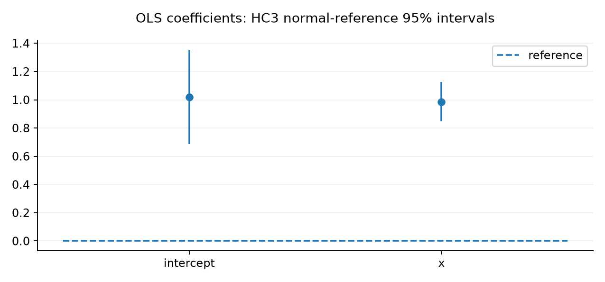

# STATADIC


*stat·adic* · /stəˈtædɪk/ · stuh-TAD-ik

A coined name from **statistic + dyadic**. A
[dyad](https://www.merriam-webster.com/dictionary/dyad) is a pair considered
together: two people, two observations, two parts of a whole. STATADIC suggests
statistical methods coming together in one analysis.

[](src/python/packages/statadic/CHANGELOG.md)
[](src/python/packages/statadic/docs/start/installation.md)
[](LICENSE)

**From statistical question to publication-ready results.**

Fit familiar models, compose richer analyses, and carry the assumptions,
diagnostics and evidence through to your final tables and figures. STATADIC
brings regression, ordination and distribution-based analysis into one consistent
Python workflow, built on JAX.

**Specify → Estimate → Diagnose → Infer or predict → Report.**

[Start](src/python/packages/statadic/docs/start/index.md) ·
[Choose a method](src/python/packages/statadic/docs/methods.md) ·
[Explore the evidence](src/python/packages/statadic/docs/validation/index.md) ·
[Blog](src/python/packages/statadic/docs/blog/index.md)

## See it in action

Estimate a line, request HC3 uncertainty, and export a manuscript table and figure:

<!-- statadic:readme-ols:start -->

```python
from pathlib import Path

from statadic.api.design import Intercept, Linear
from statadic.api.inference import HC
from statadic.api.regression import Regression

data = {
    "x": [0.0, 1.0, 2.0, 3.0, 4.0, 5.0],
    "y": [1.1, 1.8, 3.2, 3.7, 5.3, 5.8],
}
fit = Regression.ols("y", Intercept() + Linear("x")).estimate(data).require_valid()
report = fit.infer(covariance=HC("HC3")).report(reference="normal")

print(report.to_text())
report.save_latex(Path("regression.tex"))
report.coefficient_plot().save_pgfplots(Path("coefficients.tex"))
```

<!-- statadic:readme-ols:end -->

<!-- statadic:readme-table:start -->

| Parameter | Estimate | HC3 SE | 95% interval |
| --- | --- | --- | --- |
| intercept | 1.0190 | 0.1701 | [0.6857, 1.3524] |
| x | 0.9857 | 0.0708 | [0.8470, 1.1244] |

<!-- statadic:readme-table:end -->



Include the exported table directly in your manuscript:

```latex
% Preamble: \usepackage{booktabs,siunitx}
\begin{table}
  \input{regression.tex}
  \caption{OLS estimates with HC3 standard errors.}
\end{table}
```

The figure is PGFplots source; add `pgfplots` to your preamble and
`\input{coefficients.tex}`. HC3/normal intervals use an asymptotic reference.
Browse the actual [text report](src/python/apps/docs/static/readme/report.txt) and
[exported table](src/python/apps/docs/static/readme/regression.tex).
The [complete example](src/python/packages/statadic/examples/first_regression.py)
adds residual diagnostics, prediction, and saved analysis artifacts.

## But there is more: compose the analysis

**Censored durations. Seasonal splines. Unit and time effects. Spatial dependence.**

Use the same `Regression` interface. Given prepared `panel_data` and explicit
`integration_designs`, this combines a lognormal AFT model, cyclic spline, two-way
fixed effects, spatial lag and a spatially lagged predictor:

<!-- statadic:readme-composition:start -->

```python
from statadic.api.design import CyclicSpline, Linear
from statadic.api.regression import Regression
from statadic.api.spatial.graphs import SpatialLag, SpatialX
from statadic.api.survival import RightCensored, SpatialSurvivalData
from statadic.estimation.survival import SpatialSurvivalML
from statadic.model.survival import LogNormalAFT

model = Regression(
    RightCensored("duration", "event"),
    (
        Linear("x") + CyclicSpline("phase", df=3, period=1.0)
        + SpatialX("x", "neighbors")
    ),
    structure=panel_data.panel,
    law=LogNormalAFT(),
    dependence=SpatialLag("neighbors"),
    effects="two-way",
    estimator=SpatialSurvivalML(rho_fixed=0.2),
)
result = model.estimate(SpatialSurvivalData(panel_data, integration_designs))
print(result.report().to_text())
```

<!-- statadic:readme-composition:end -->

This [integration example](src/python/packages/statadic/tests/api/test_survival_composition.py)
also exercises a censored spell and a missing node. It fixes the spatial
coefficient at 0.2; spline terms are unpenalized. The
[survival guide](src/python/packages/statadic/docs/survival-models.md) explains
data preparation, estimation and integration refinement.

The same design vocabulary also supports
[principal-component regression](src/python/packages/statadic/examples/principal_component_regression.py),
[count models](src/python/packages/statadic/examples/poisson_exposure.py) and
[distribution-valued observations](src/python/packages/statadic/examples/distribution_workflow.py).

<!-- rumdl-disable MD026 -->

## Now let's get fancy...

<!-- rumdl-enable MD026 -->

**Train a representation through SAR.** The [complete example](src/python/packages/statadic/examples/neural_sar.py)
prepares vector distributions `clouds`, period designs `design`, outcomes `y`,
empty error graphs `no_errors`, and `NeuralSAR`: a Flax NNX 6 → 8 → 2 MLP
with trainable rho.

<!-- statadic:readme-neural-sar:start -->

```python
import jax.numpy as jnp
import optax
from flax import nnx
from statadic.api.representation import Energy
from statadic.estimation.spatial.graph_likelihood import graph_profile
from statadic.operators.spatial.distance import rbf_weights

model = NeuralSAR()
optimizer = nnx.Optimizer(model, optax.adam(0.01), wrt=nnx.Param)

def objective(model):
    projected = clouds.with_coordinates(model(clouds.coordinates))
    cost = Energy(ground="euclidean").squared_cross(projected, projected)
    upper = jnp.triu(cost, k=1)
    weights = rbf_weights(upper + upper.T, jnp.asarray(1.0))
    _, _, log_likelihood = graph_profile(
        (weights[None],) * len(y), no_errors, design, tuple(y), model.rho[None]
    )
    return -log_likelihood / y.size

@nnx.jit
def step(model, optimizer):
    value, gradients = nnx.value_and_grad(objective)(model)
    optimizer.update(model, gradients)
    return value

for _ in range(120):
    step(model, optimizer)
```

<!-- statadic:readme-neural-sar:end -->

Gradients traverse energy costs, graph weights and SAR likelihood. Bandwidth is
fixed; rho is bounded. The example's final `Regression` report conditions on the
learned graph, excluding training uncertainty. Install Flax to run it.

## Trust you can inspect

Follow a method from its tests to its mathematics, matched reference configuration
and published sources. Each link opens the evidence behind that part of the method.

| Method | Test suites | Selected Lean 4 mathematics | Independent comparisons | Sources / BibTeX |
| --- | --- | --- | --- | --- |
| OLS / WLS | [✓ Fits and invariants](src/python/packages/statadic/tests/estimation/test_linear.py) | [Gauss–Markov](src/lean/packages/StatadicFormal/StatadicFormal/Estimation/Linear/GaussMarkov.lean), [WLS](src/lean/packages/StatadicFormal/StatadicFormal/Estimation/Linear/WLS.lean) | [statsmodels](src/python/packages/statadic/tests/estimation/test_linear_reference.py) | [✓ Sources](.context/reference/stepniak-gauss-markov-2010/README.md) |
| Binomial / Poisson GLMs | [✓ Fits and covariance](src/python/packages/statadic/tests/estimation/test_glm.py) | [Score and curvature](src/lean/packages/StatadicFormal/StatadicFormal/Estimation/GLM/CanonicalLikelihood.lean) | [statsmodels](src/python/packages/statadic/tests/estimation/test_glm.py) | [✓ Sources](.context/reference/nelder-wedderburn-1972/README.md) |
| Fixed-effects panels | [✓ Estimation contracts](src/python/packages/statadic/tests/estimation/test_panel_validation.py) | [Weighted two-way projections](src/lean/packages/StatadicFormal/StatadicFormal/Operators/Panel/TwoWay.lean) | [linearmodels](src/python/packages/statadic/tests/estimation/test_panel_reference.py) | [✓ Sources](.context/reference/stammann-weighted-effects-2018/README.md) |
| Parametric AFT survival | [✓ Likelihood and prediction](src/python/packages/statadic/tests/model/survival/test_aft.py) | [AFT families](src/lean/packages/StatadicFormal/StatadicFormal/Estimation/Survival/AFTFamilies.lean) | [lifelines, selected configurations](src/python/packages/statadic/tests/testing/test_survival_references.py) | [✓ Sources](.context/reference/kalbfleisch-prentice-2002/README.md) |
| Spatial panels | [✓ Observed-panel contracts](src/python/packages/statadic/tests/estimation/spatial/test_observed_panel.py) | [Filter Jacobians](src/lean/packages/StatadicFormal/StatadicFormal/Estimation/Spatial/PanelJacobian.lean) | [spreg, selected configurations](src/python/packages/statadic/tests/integration/api/test_spatial_reference_walkthroughs.py) | [✓ Sources](.context/reference/elhorst-spatial-panel-2003/README.md) |
| Energy statistics / MMD | [✓ Weighted reductions](src/python/packages/statadic/tests/discrepancy/mmd/test_weighted.py) | [Selected nonnegativity results](src/lean/packages/StatadicFormal/StatadicFormal/Discrepancy/MMD/Nonnegativity.lean) | [NumPy controls](src/python/packages/statadic/tests/discrepancy/test_mmd_independent_reference.py), [dcor](src/python/packages/statadic/tests/discrepancy/mmd/test_energy_independent_reference.py) | [✓ Sources](.context/reference/sejdinovic-equivalence-2013/README.md) |

✓ identifies linked evidence, rather than a coverage percentage or a live passing
result. Lean proves the stated mathematical results; numerical implementations,
external comparisons and statistical studies have their own scopes. See the
[claim registry](src/lean/registry/claims.json),
[reference mappings](src/python/packages/statadic/docs/validation/references.md),
[study dispositions](src/python/packages/statadic/docs/validation/research.md) and
[known limits](src/python/packages/statadic/docs/validation/known-limitations.md).
Citation records generate the shared [BibTeX bibliography](src/latex/refs.bib).

## JAX underneath, statistical workflows on top

Supported numerical kernels compose with `jit` and `vmap`. Named preparation and
reporting stay eager; fitted state carries through to inference and prediction.
JAX supplies CPU, GPU and TPU backends. Current STATADIC reference and performance
evidence covers CPU; inspect the
[method-specific transformation and performance scope](src/python/packages/statadic/docs/capabilities.md)
when choosing a workload or device.

## Try it

From a checkout, using Python 3.13:

```bash
uv venv --python 3.13
uv pip install ./src/python/packages/statadic
```

Run the example with `.venv/bin/python`. See
[installation](src/python/packages/statadic/docs/start/installation.md) for optional
table/plot extras and Python 3.14 compatibility scope. Repository environments
target Linux x86-64 and ARM64.

For development, use the pinned devenv shell and [contributor commands](CONTRIBUTING.md).
After `just setup`, build the site with `just python::docs::build` and preview it
with `just python::docs::serve`.
