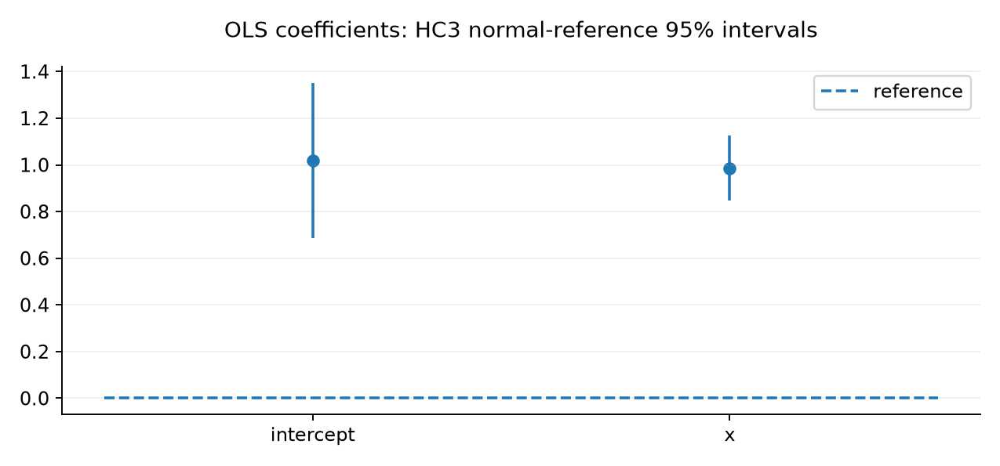

# Introducing Statadic: From Statistical Question to Published Result

Marcus Gawronsky · 12 November 2026

## What should statistical software carry with a result?

Fitting a regression has become a routine part of empirical research. Yet the
coefficient printed in a table depends on decisions about how observations are
represented, which model is estimated and how uncertainty is calculated. As an
analysis develops, those decisions often spread across scripts, library defaults
and manuscript notes, making their relationships increasingly difficult to
reconstruct.

I wanted a statistical workflow in which those relationships remained visible as
the research became more complicated. My recent writing on machine-checkable
mathematics explored how proofs might become reusable research objects. Statistical software
presents a related challenge: making an implementation easier to produce,
including with AI assistance, increases the importance of being able to inspect
what justifies its results.

Statadic is a Python library built on JAX that connects model specification,
estimation, diagnostics, inference and reporting through reusable components.
The name combines *statistic* and *dyadic*: a
[dyad](https://www.merriam-webster.com/dictionary/dyad) is a pair considered
together, whether two people or two observations. The name suggests statistical
methods coming together in one analysis. Its intended audience is researchers who
want to begin with familiar models and extend their analyses while retaining
access to the assumptions, numerical diagnostics and evidence behind them.

## From a regression to a manuscript

A simple example begins with ordinary least squares. We declare a response and
design, estimate the coefficients, then request HC3 uncertainty. The distinction
between fitting and inference matters: replacing HC3 with another supported
covariance procedure uses the same retained fit, while changing how its
uncertainty is estimated.

```python
from pathlib import Path

from statadic.api.design import Intercept, Linear
from statadic.api.inference import HC
from statadic.api.regression import Regression

data = {
    "x": [0.0, 1.0, 2.0, 3.0, 4.0, 5.0],
    "y": [1.1, 1.8, 3.2, 3.7, 5.3, 5.8],
}
fit = Regression.ols("y", Intercept() + Linear("x")).estimate(data).require_valid()
report = fit.infer(covariance=HC("HC3")).report(reference="normal")

print(report.to_text())
report.save_latex(Path("regression.tex"))
report.coefficient_plot().save_pgfplots(Path("coefficients.tex"))
```

The report makes the normal reference explicit. HC3 belongs to the family of
heteroskedasticity-consistent covariance estimators examined by
[MacKinnon and White (1985)](https://qed.econ.queensu.ca/working_papers/papers/qed_wp_537.pdf);
choosing it does not establish the coverage of an interval in a particular
sample. The figure below previews the coefficient estimates and asymptotic 95%
intervals produced by this example.



The same report exports a
{download}`LaTeX table <../../../../apps/docs/static/readme/regression.tex>`
and {download}`PGFplots figure <../../../../apps/docs/static/readme/coefficients.tex>`
for inclusion in a manuscript with `\input{regression.tex}` and
`\input{coefficients.tex}`. With `booktabs`, `siunitx` and `pgfplots` in the
preamble, the manuscript controls their typography. Reporting reuses the
computed results without refitting; diagnostics and predictions remain available
through the fitted model.

## When the research question becomes more complicated

Consider a study of how long facilities remain operational. Some are still
operating when observation ends, seasonal conditions affect durations, and
facilities are observed across units and periods. Neighbouring facilities may
also have dependent outcomes. Addressing these features requires specifying how
they enter the analysis together.

Statadic's design vocabulary can combine a lognormal accelerated failure-time
model, a cyclic spline, unit and time effects, and spatial dependence through
the same `Regression` interface. Given prepared `panel_data` and
`integration_designs`, the specification is:

```python
from statadic.api.design import CyclicSpline, Linear
from statadic.api.regression import Regression
from statadic.api.spatial.graphs import SpatialLag
from statadic.api.survival import RightCensored, SpatialSurvivalData
from statadic.estimation.survival import SpatialSurvivalML
from statadic.model.survival import LogNormalAFT

model = Regression(
    RightCensored("duration", "event"),
    Linear("x") + CyclicSpline("phase", df=3, period=1.0),
    structure=panel_data.panel,
    law=LogNormalAFT(),
    dependence=SpatialLag("neighbors"),
    effects="two-way",
    estimator=SpatialSurvivalML(),
)
result = model.estimate(SpatialSurvivalData(panel_data, integration_designs))
print(result.report().to_text())
```

This SAR-style composition estimates the spatial coefficient and uses an
unpenalized spline basis. The small fixture used to exercise it does not qualify
integration accuracy. Graphs, censoring roles and numerical integration inputs
are explicit; the [survival guide](../reference/survival.md) explains their
preparation and limitations.

<!-- rumdl-disable MD026 -->

## But this is where things get fancy...

<!-- rumdl-enable MD026 -->

JAX supports the numerical work beneath these workflows. Where their contracts
allow it, estimator components can be compiled with `jit` and evaluated across
repeated inputs with `vmap`, making simulation studies practical without
maintaining a separate estimator implementation. Named data preparation and
report rendering remain eager operations. JAX offers CPU, GPU and TPU backends;
Statadic's current [performance evidence](../reference/transformation-support.md) covers CPU workloads.

## What would justify trusting the answer?

Different checks address different questions. Unit tests exercise implementation
behaviour; [matched reference comparisons](../validation/references.md) examine
agreement with libraries including statsmodels, lifelines and dcor. Statistical
studies ask how a complete procedure behaves under specified sampling
conditions. Agreement between two implementations can be useful evidence even
when the inferential procedure they compute performs poorly.

The draft paper illustrates this distinction with 10,000 trials per sample size
in float64 on CPU. With 25 observations, lognormally distributed predictors and
heteroskedastic errors, nominal 95% normal-reference slope intervals had the
coverage below. Unavailable intervals counted as uncovered. HC3 improved coverage
substantially, yet remained below the nominal level. These are
{download}`retained draft-paper values <../../../../../latex/projects/01_statadic/src/generated/values.tex>`
with {download}`recorded provenance <../../../../../latex/projects/01_statadic/src/generated/provenance.json>`;
they were not rerun for this post and do not establish general qualification.

| Covariance procedure | Observed coverage | Nominal coverage |
| --- | --- | --- |
| HC0 | 69.2% | 95% |
| HC3 | 86.9% | 95% |

Selected mathematical statements are also checked in Lean 4, with their
assumptions, literature and relationships to Python recorded in the
[claim registry](../formal/index.md). These proofs establish the stated
mathematics; correspondence to compiled JAX execution remains unverified, and
human semantic review of the source mappings is pending. Following a method
through these records makes its supporting evidence and unresolved obligations
available for scrutiny as the implementation develops.

## A release to build on

This alpha brings together regression, panel, spatial, survival and
distribution-based workflows, alongside reporting and evidence infrastructure.
Its [known limitations](../validation/known-limitations.md) include adverse and
inconclusive statistical results. Users need to assess the configuration they
intend to use, including its numerical and inferential requirements.

The repository also draws on
[Exordio](https://marcusinthesky.github.io/exordio/), whose shared development
environment and validation conventions help maintain Python, Lean, documentation
and LaTeX together. Keeping these materials alongside one another allows changes
to the software and its supporting research to be inspected together.

Start with the [installation guide](../start/installation.md), run the regression
above and inspect its exported table. Then follow one method into its reference
comparisons and mathematics. Feedback on missing workflows, confusing assumptions
and conflicting results will help determine what Statadic needs to support next.
